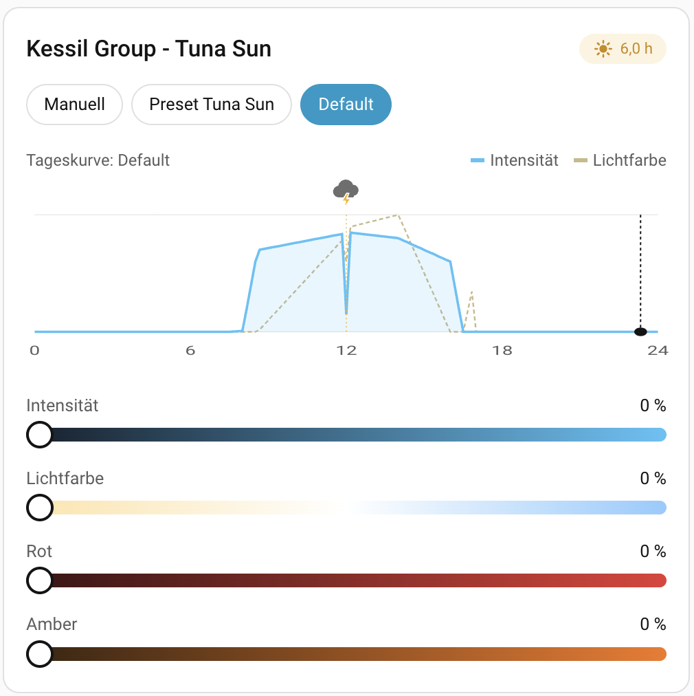

# Home Assistant (HA) Integration for Kessil Wifi Dongle

Unofficial, local-only Home Assistant integration for the **Kessil WiFi dongle**
(KSAWD01), developed with **A360X Tuna Sun** lamps. The KSAWD01 works with the
A360X, A360XE and A500X (via K-Link); only Tuna Sun has been tested. Includes a Lovelace card with mode
buttons, the daily curve and channel sliders.

> Not affiliated with or endorsed by Kessil. "Kessil" is used only to describe
> which device this works with.

## Features

Per lamp group on the dongle:

| Entity | What it does |
|---|---|
| `light` | Operating state and intensity (see below). |
| `number` Intensity / Color temperature / Red / Amber | Channels in % (Tuna Sun; other lamp types: Intensity / Spectrum) |
| `select` Mode | `Manual` or one of the programs stored on the dongle |
| `sensor` Lamps | Number of lamps in the group (diagnostic) |

Plus one overheat status sensor per lamp (diagnostic), and actions to back up,
save, rename and delete the dongle's programs (see [Program management](#program-management)).

**On/off** shows the operating state rather than a power switch:

| State | Light |
|---|---|
| A program runs (even while its values are 0, e.g. at night) | on |
| Manual, intensity, red and amber all 0 | off |
| Manual, at least one of them above 0 | on |

Red and amber are separate LEDs, so they count on their own. Turning *off*
switches to manual with these channels at 0. Turning *on* switches to manual with
the intensity stored in the dongle (about 50 % if that is 0). Any slider change
also switches to manual, starting from the manual values stored in the dongle.
Home Assistant does not remember any values itself.

Each lamp group becomes one device, named after the lamp type as in the Kessil app
(e.g. *Kessil Group - Tuna Sun*). The dongle itself and single lamps are not separate devices.

Communication is local TCP (port 8888), polled every 60 seconds. No cloud, no app
needed after the dongle has been set up once.

## Installation

### HACS (custom repository)

1. HACS → ⋮ → *Custom repositories* → add `https://github.com/Matthis/Kessil_HA`,
   category *Integration*.
2. Install **Kessil WiFi Dongle** and restart Home Assistant.

### Manual

Copy `custom_components/kessil_dongle` into your HA `config/custom_components/`
folder and restart.

### Setup

*Settings → Devices & services → Add integration → Kessil WiFi Dongle*, then enter
the dongle's IP address. Give the dongle a fixed IP (DHCP reservation). If HA and the
dongle are in different VLANs, allow TCP 8888 from HA to the dongle.

## Lovelace card



The card is shipped with the integration and loaded automatically – no extra
resource needed.

```yaml
type: custom:kessil-card
entity: light.kessil_group_tuna_sun
name: Aquarium   # optional
```

The other entities (intensity, color temperature, red, amber, mode) are found
automatically through the light's device.

- Top right: the daily light amount of the running program, in hours at full
  intensity (in manual mode: intensity × 24 h).
- Top: mode buttons (manual or one of the dongle's programs) and the daily curve
  with intensity (solid), color temperature (dashed), a marker for now and a
  cloud-with-lightning symbol where the program has a thunderstorm effect. In manual
  mode the curve is a constant line at the current values.
- Below: sliders for intensity, color temperature, red and amber. For Tuna Sun groups
  the color temperature slider shows the range (warm 6000 K – 9000 K cool); other
  lamp types get a neutral "Spectrum" slider. Moving one switches
  to manual mode, starting from the manual values stored in the dongle.

## Example program: Natural Day

[`programs/natural_day.json`](programs/natural_day.json) is a suggestion for a
natural daily curve for Tuna Sun: light from 08:00 to 19:00 with a daily light
amount of about 6 hours at full intensity, shaped like a real day.


| Time | What happens |
|---|---|
| 08:00–08:40 | Dawn: amber glows first, red joins; sunrise peak at 08:40 in deep orange (amber 92, red 46) with almost no intensity |
| 08:40–10:30 | Morning: amber and red fade, intensity rises smoothly, color temperature moves from warm to neutral |
| 10:30–13:30 | Midday: slow rise to the zenith at 13:30 (intensity 78 %, color temperature 61 %) |
| 13:35 | Thunderstorm: the dongle's own storm effect for 5 minutes, then it clears up |
| 15:40–18:30 | Afternoon: gradually warmer and dimmer; sunset glow at 18:30 (amber 92, red 49) |
| 18:30–19:00 | Dusk: red and amber fade out, night from 19:00 |

The file uses the dongle's program format (points with `minutes`, `UI`, `eid`,
`duration`, `freq`); upload it with the `save_program` action (see below). Adapt it with
`scripts/natural_day.py` (day start/end and the shape table at the top; channel
amounts are scaled to a reference program) and draw it with `scripts/plot_program.py`.

## Program management

Actions to manage the programs stored in the dongle. They take any light entity
of a Kessil lamp group and work on the programs of that group's lamp type.
Writing actions change only the dongle's program list; they never start a
program.

| Action | What it does |
|---|---|
| `kessil_dongle.export_programs` | Returns all programs as data (back them up before changing anything) |
| `kessil_dongle.save_program` | Creates a program, or overwrites your own program with the same name |
| `kessil_dongle.rename_program` | Renames one of your programs |
| `kessil_dongle.delete_program` | Deletes one of your programs (not while it is running) |

Presets that come with the dongle (e.g. "Preset Tuna Sun") cannot be
overwritten, renamed or deleted. Before anything is sent, the integration checks
the limits of the dongle: 2–20 points, names up to 31 bytes, red and amber 0–100
on Tuna Sun, and at least one point with intensity 0 (otherwise the light never
goes off). The dongle itself does not check the name length, and longer names
corrupt its program list.

Example: upload [Natural Day](#example-program-natural-day). Paste the `points`
from [`programs/natural_day.json`](programs/natural_day.json) in Developer
tools → Actions:

```yaml
action: kessil_dongle.save_program
data:
  entity_id: light.kessil_group_tuna_sun
  name: Natural Day
  points:
    - {minutes: 480, UI: [0, 0, 0, 0, 0]}
    - {minutes: 815, UI: [36, 93, 0, 6, 0], eid: 0, duration: 300, freq: 0}
    # ...
    - {minutes: 1140, UI: [0, 0, 0, 0, 0]}
```

| Point field | Meaning |
|---|---|
| `minutes` | Minutes after midnight (dongle time zone) |
| `UI` | 5 channel values; Tuna Sun: intensity 0–255, color temperature 0–255, unused, red 0–100, amber 0–100 |
| `eid` | Optional effect at this point: `0` thunderstorm, `1` clouds, `3` aurora, `2` rainbow (Tuna Blue only) |
| `duration`, `freq` | Effect length (30–300 s, steps of 30) and frequency (0–2) |

The output of `export_programs` uses the same point format, so an exported
program can be saved again as it is. The new program appears in the mode
select after a few seconds.

## Roadmap

- **Program editor in the card**: edit the daily curve of a program directly in
  the Lovelace card (the actions above already cover saving, renaming and
  deleting).
- **Generated daily program**: sunrise and sunset following the real sun times
  and a random midday thunderstorm, written to the dongle once a day (so the
  lamps keep running on their own if Home Assistant is down).
- **Acclimation and moon phase** settings, which the dongle already reports.
- **More lamp types**: Tuna Blue, A500X and Refugium are untested. If you own one,
  please open an issue. Anonymised responses of the read-only commands in
  [docs/PROTOCOL.md](docs/PROTOCOL.md) (102, 105, 106) are enough to start.

## Notes

- The dongle's daily program runs on the dongle's own clock and time zone.
- While a program runs, the dongle does not report the lamps' current output, only
  the stored manual values. The integration therefore computes the current values
  from the program curve (linear fade between points, dongle time zone).
- Only Tuna Sun channel mapping is verified. Other lamp types get intensity and
  color only.
- The integration icon (shown from Home Assistant 2026.3) is original artwork,
  generated by `scripts/make_icon.py`; it is not a Kessil logo.
- Protocol details: [docs/PROTOCOL.md](docs/PROTOCOL.md).

## Development

```sh
uv venv --python 3.13 .venv
uv pip install --python .venv -r requirements_test.txt
.venv/bin/python -m pytest
```

Tests run against a fake dongle (recorded, anonymised responses in
`tests/fixtures/`) and a real Home Assistant core – no device needed.

## License

MIT – see [LICENSE](LICENSE).
